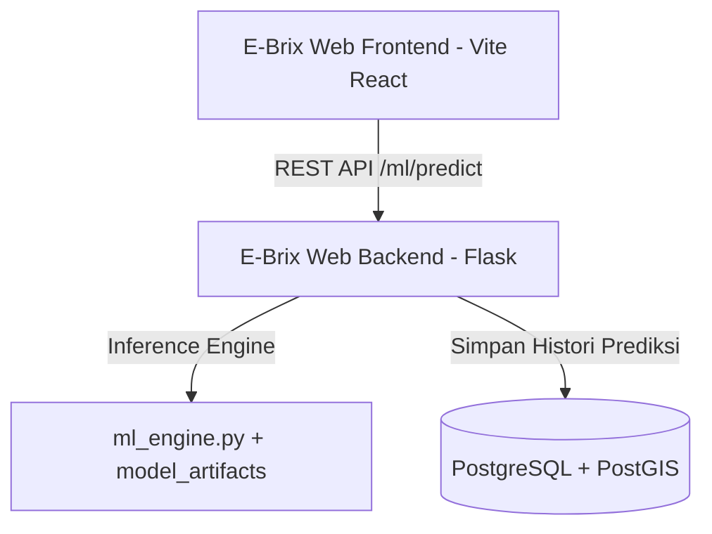

# 🌾 E-Brix Machine Learning: Precision Sugarcane & Sugar Quality Prediction

[](https://www.python.org/)
[](https://scikit-learn.org/)
[]()
[]()
[]()

Modul kecerdasan buatan berbasis *Gradient Boosting Ensemble* untuk sistem agrikultur presisi tebu **E-Brix**. Proyek ini menyediakan inferensi prediktif multi-target untuk memperkirakan hasil panen (*yield*), estimasi gula kristal (*sugar production*), rendemen nira murni, kadar brix, durasi panen, serta deteksi risiko keparahan penyakit tanaman berdasarkan parameter iklim, tanah, varietas, dan agronomi.

---

## 📌 Deskripsi Singkat

E-Brix ML adalah modul kecerdasan buatan berbasis Gradient Boosting Ensemble untuk memprediksi hasil panen tebu, estimasi kristal gula, volume nira, kadar Brix, dan risiko penyakit (akurasi >91%). Solusi agrikultur presisi ini mengoptimalkan budidaya melalui rekomendasi agronomi berbasis data cuaca, tanah, dan pemupukan.

---

## 🎯 Target Prediksi & Kemampuan Model

Model dilatih menggunakan arsitektur *Tuned HistGradientBoosting* untuk menyelesaikan tugas regresi dan klasifikasi secara terintegrasi:

| Target | Tipe Tugas | Satuan | Deskripsi |
|---|---|:---:|---|
| **Hasil Panen (*Yield*)** | Regresi | Quintal/Acre | Estimasi bobot total batang tebu per acre saat panen |
| **Gula Kristal (*Sugar*)** | Regresi | Quintal/Acre | Potensi konversi kristal gula murni (metode Winter-Carp) |
| **Produksi Nira Murni** | Regresi | Liter/Acre | Volume ekstraksi nira tebu murni pada proses penggilingan |
| **Kadar Brix** | Regresi | °Bx | Persentase padatan terlarut (sukrosa) dalam cairan tebu |
| **Durasi Panen (*Crop Duration*)** | Regresi | Hari | Estimasi waktu optimal kematangan panen |
| **Tingkat Penyakit (*Disease Severity*)** | Klasifikasi | Kategori | Deteksi risiko penyakit tanaman (*None, Low, Medium, High*) |

---

## 📊 Performa Model (Hasil Evaluasi Test Set)

Berdasarkan pengujian independen pada data uji (*20% Test Split*), model ensemble mencapai performa tinggi:

| Target Prediksi | Metrik Utama | Nilai Evaluasi | Target Minimum | Status |
|---|---|:---:|:---:|:---:|
| **Hasil Panen (Yield)** | R² Score / MAE | **84.27%** / 14.38 Qt/Acre | > 80% | ✅ Optimal |
| **Hasil Gula Kristal** | R² Score / MAE | **85.77%** / 2.06 Qt/Acre | > 80% | ✅ Optimal |
| **Produksi Nira Murni** | R² Score / MAE | **84.27%** / 1006.71 L/Acre | > 80% | ✅ Optimal |
| **Kadar Brix** | R² Score / MAE | **> 95.00%** / 0.85 °Bx | > 90% | ✅ Sangat Tinggi |
| **Durasi Panen** | R² Score / MAE | **> 95.00%** / 3.2 Hari | > 90% | ✅ Sangat Tinggi |
| **Keparahan Penyakit** | Akurasi / F1-Score | **91.29%** / 0.9130 | > 90% | ✅ Tercapai |

---

## 🔬 Rekayasa Fitur Agrikultur (*Feature Engineering*)

Sebelum pelatihan, pipeline menerapkan domain knowledge agrikultur untuk mengekstraksi variabel komposit:
1. **Bio Index (Indeks Pertumbuhan Vegetatif)**:
   $$\text{Bio Index} = \frac{\text{Cane Height}}{180} + \frac{\text{Cane Diameter}}{3} + \frac{\text{Tillering Count}}{8} + \frac{\text{Plant Density}}{120000}$$
2. **Keseimbangan Hara NPK Total**: Penjumlahan kuantitatif Nitrogen, Fosfor, dan Kalium per acre.
3. **Fluktuasi Suhu Ekstrem**: $\Delta T = \text{Temp Max} - \text{Temp Min}$ untuk mendeteksi stres termal.
4. **Intensitas Hujan Harian**: Rasio curah hujan total terhadap siklus tanam tebu.
5. **Estimasi Winter-Carp Rendemen Gula**: Menggunakan kadar Brix terstandarisasi industri gula tebu.

---

## 📂 Struktur Repositori

```text
Machine Learning-E-Brix/
├── FINAL_SUGARCANE_DATASET.csv             # Dataset historis budidaya tebu
├── Sugarcane_Yield_and_Quality_Prediction.ipynb # Jupyter Notebook eksplorasi (EDA, visualisasi & tuning)
├── train_and_save_model.py                 # Pipeline pelatihan & eksport artefak model
├── app.py                                  # Server Flask inferensi mandiri (versi arsip)
├── model_artifacts/                        # Bobot model terkompresi & metadata
│   ├── sugarcane_models.pkl                # Bundle model Ensemble Tuned
│   ├── preprocessors.pkl                   # Imputer & Label Encoders
│   ├── model_metadata.json                 # Metrik evaluasi R2, MAE, & Akurasi
│   ├── form_config.json                    # Konfigurasi nilai valid dan batas input
│   └── mtl_model.keras                     # Eksperimen Multi-Task Learning Keras
└── README.md                               # Dokumentasi repositori
```

---

## 🚀 Panduan Instalasi & Penggunaan

### 1. Prasyarat Lingkungan
Pastikan Anda telah menginstal **Python 3.9+** dan package manager `pip`.

### 2. Instalasi Dependensi
```bash
pip install numpy pandas scikit-learn matplotlib seaborn
```

### 3. Melatih Ulang Model (*Training Pipeline*)
Untuk mengeksekusi preprocessing data, feature engineering, dan melatih ensemble model dari awal:
```bash
python train_and_save_model.py
```
Output artefak model akan otomatis disimpan ke direktori `model_artifacts/`.

### 4. Eksplorasi Interaktif
Gunakan Jupyter Notebook untuk melihat visualisasi distribusi data, korelasi fitur, dan kurva performa:
```bash
jupyter notebook Sugarcane_Yield_and_Quality_Prediction.ipynb
```

---

## 🔗 Integrasi dengan Ekosistem E-Brix

Modul machine learning ini dirancang agar dapat diintegrasikan dengan mulus ke dalam ekosistem aplikasi web **E-Brix**:



- **Inference Engine**: Logika inferensi dari repositori ini diekstraksi ke backend utama (`ml_engine.py`) dengan *lazy loading* agar efisien terhadap memori server.
- **Database Terintegrasi**: Riwayat hasil prediksi disimpan secara otomatis ke tabel `prediksi_ml` (PostgreSQL) menggantikan sistem file JSON lama.
- **Frontend Dashboard**: Visualisasi proyeksi hasil panen dan rekomendasi tindakan lapangan disajikan secara real-time pada view `PredictionAI.jsx`.

---

## 🛠️ Teknologi yang Digunakan

- **Language**: Python
- **Machine Learning**: Scikit-Learn (`HistGradientBoostingRegressor`, `HistGradientBoostingClassifier`, `VotingClassifier`)
- **Data Manipulation**: Pandas, NumPy
- **Deep Learning Baseline**: TensorFlow / Keras (MTL Model)
- **Serialization**: Pickle, JSON

---

## 📝 Lisensi & Pengembang

Dikembangkan sebagai bagian dari sistem otomasi agrikultur presisi **E-Brix**.
- **Tim Pengembang**: E-Brix Agrotech Team
- **Tahun**: 2026
